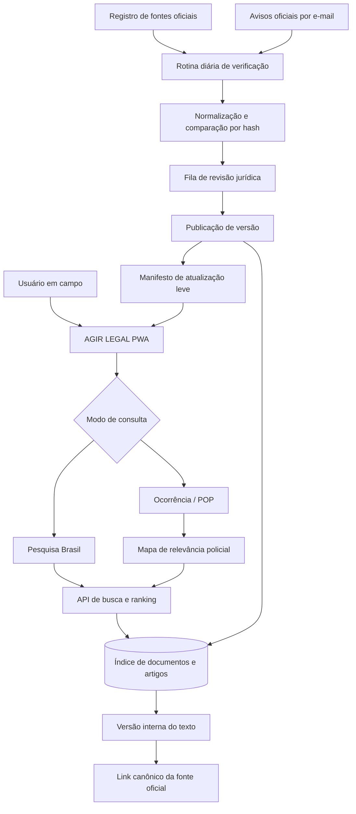

# Solução de integração: AGIR LEGAL + acervo jurídico

**Objetivo.** Transformar a interface já criada em uma aplicação de consulta operacional para a Polícia Militar, mantendo a resposta rápida para ocorrências e, ao mesmo tempo, disponibilizando uma pesquisa ampla da legislação brasileira a partir de fontes oficiais. A proposta evita transferir ao celular todo o conteúdo jurídico existente no repositório e substitui a ideia de “cópia integral sempre atualizada” por um processo auditável de detecção, validação e publicação de mudanças.

> **Princípio central:** o usuário recebe primeiro a orientação operacional vinculada à ocorrência; a consulta legislativa nacional permanece disponível em segundo nível, com fonte, data de conferência, situação normativa e link oficial sempre visíveis.

## 1. Diagnóstico do material existente

O repositório `www.direitomobile.com` já contém a matéria-prima correta para uma transição gradual. Seu gerador percorre os HTMLs do acervo, limpa o texto, reconhece artigo, parágrafo, inciso e alínea, gera um JSON por documento e publica um catálogo resumido. O leitor carrega o conteúdo integral apenas quando o documento é aberto, em vez de carregar o acervo inteiro de uma vez.[2] [3]

| Evidência encontrada | Implicação para o AGIR LEGAL |
| --- | --- |
| O relatório registra **539 documentos**, **157.701 blocos** e **19.059 referências de artigos**. [1] | A pesquisa ampla deve sair do navegador e passar a ser atendida por servidor e banco de dados. |
| Os JSONs extraídos ocupam cerca de **98,8 MB** e alguns documentos individualmente passam de 5 MB. [1] | O aplicativo móvel não deve incorporar esse corpus no pacote inicial nem no cache padrão. |
| O mecanismo atual normaliza acentos, trata referências de lei/artigo/inciso/alínea e atribui relevância a resultados. [3] | A lógica de interpretação da consulta pode ser portada para TypeScript e reaproveitada na camada de busca. |
| Há metadados inconsistentes em pelo menos uma amostra de documento militar extraído. | Todo conteúdo vindo do acervo legado precisa de fonte canônica, hash, data de conferência e revisão antes de virar texto operacional. |
| O PR aberto do projeto prevê importação progressiva, conferência oficial, busca semântica e comentários compartilhados. [4] | A direção proposta aproveita a intenção já registrada, sem transportar o HTML legado ou suas camadas de apresentação. |

O ponto que deve ser preservado é o **modelo de extração e leitura em demanda**, não o espelho de páginas nem as anotações de terceiros. Textos legais, comentários editoriais, jurisprudência e materiais didáticos possuem tratamentos de autoria e licenciamento diferentes. Antes de reaproveitar comentários, notas ou organização textual do acervo, deve ser confirmada a autorização correspondente. O novo sistema deve priorizar o texto oficial e registrar explicitamente qualquer conteúdo editorial próprio.

## 2. Como conciliar foco policial-militar e busca brasileira ampla

O produto deve operar em duas camadas conectadas, não em um catálogo único e indiferenciado. Assim, a interface mantém a velocidade necessária à atividade policial, mas não limita o usuário quando ele precisa consultar uma norma fora do roteiro de ocorrência.

| Camada | Finalidade | Conteúdo | Comportamento no aplicativo |
| --- | --- | --- | --- |
| **Operacional PM** | Responder a uma situação de campo. | Ocorrências, POPs autorizados, cartões de segurança, fluxos, dispositivos legais correlatos e contatos úteis. | É a entrada padrão; apresenta resultados curtos, ordenados e acionáveis. |
| **Pesquisa Brasil** | Localizar diploma, artigo ou trecho jurídico. | Catálogo nacional de documentos, artigos e versões homologadas, com filtro de fonte e situação normativa. | Fica em uma rota própria, acessível pela busca global e por “ver base legal” da ocorrência. |
| **Fonte oficial** | Permitir conferência da origem e da vigência. | URL canônica, data de coleta, hash, status e histórico de versões. | Todo resultado abre o texto interno versionado e mantém o botão “Conferir fonte oficial”. |

A base oficial da Presidência permite pesquisa por termos no conteúdo e metadados dos atos, além de filtros por tipo, número, data, situação, origem, autoridade signatária e fonte de publicação.[6] O Portal da Legislação também organiza diplomas por categorias como códigos, leis, decretos, medidas provisórias e estatutos.[5] Essa cobertura é apropriada para o **núcleo federal**, mas não deve ser apresentada como se abrangesse, por si só, toda a legislação estadual e municipal brasileira. Para cada nova esfera, será necessário adicionar uma fonte oficial específica e identificar sua competência no resultado.

## 3. Alternativas de implantação

Há três rotas viáveis. A decisão pode considerar orçamento, autonomia de atualização e exigência de uso offline. A especificação técnica das seções seguintes detalha a alternativa intermediária porque ela concilia leveza, pesquisa e governança, mas a escolha final de implantação permanece sua.

| Abordagem | Trocas envolvidas | Custo operacional | Complexidade de implantação |
| --- | --- | --- | --- |
| **Catálogo operacional local + links oficiais** | É muito leve e funciona offline para o conteúdo curado, mas a busca nacional apenas redireciona ao portal oficial. | Baixo. Não há base jurídica central nem rotina de importação. | Baixa. |
| **Catálogo curado + índice central pesquisável + atualização diária** | Mantém o app leve, permite busca ampla e revisão de alterações antes de publicar. Requer backend, banco e rotina de sincronização. | Moderado e previsível. A rotina é programada, não contínua. | Média. |
| **Espelho integral de toda a legislação com atualização automática irrestrita** | Promete maior autonomia, porém amplia custo, risco de desatualização silenciosa, licenças, armazenamento e esforço de validação. | Alto. | Alta. |

## 4. Arquitetura recomendada para a alternativa intermediária

O aplicativo atual deve receber uma camada de dados e uma área administrativa; isso exige evoluí-lo de frontend estático para uma aplicação com banco de dados, autenticação de administradores e procedimentos de servidor. O cliente continuará pequeno. O acervo integral ficará no backend e em armazenamento de objetos, sendo transferido ao aparelho em trechos sob demanda.

### 4.1. Dados e índice

O novo banco não deve salvar HTML de origem como verdade jurídica. A proposta é armazenar metadados estruturados para a busca e preservar a resposta de fonte somente como evidência de conferência.

| Entidade | Campos essenciais | Uso principal |
| --- | --- | --- |
| `legal_source` | autoridade, escopo, URL-base, política de acesso, periodicidade | Identifica se o conteúdo é Planalto, fonte estadual, municipal ou outra origem aprovada. |
| `legal_document` | identificador canônico, tipo, número, data, ementa, situação, URL oficial, tema | É o registro de alto nível utilizado em filtros e resultados. |
| `legal_version` | documento, hash, fonte de coleta, recebido em, conferido em, status de revisão | Mantém o histórico e permite demonstrar o que mudou. |
| `legal_unit` | versão, ordem, artigo, parágrafo, inciso, alínea, texto normalizado | Alimenta a busca granular sem abrir um documento inteiro. |
| `occurrence_legal_map` | ocorrência, unidade legal, peso, papel operacional, observação aprovada | Liga a consulta policial-militar à base legal correspondente. |
| `change_event` | versão anterior, nova versão, tipo de alteração, fonte, impacto, revisão | Forma o painel de atualizações e a fila de homologação. |
| `offline_pack` | coleção, versão, lista de itens, tamanho, validade | Define o que pode ser baixado para uso sem conexão. |

O índice de busca deve trabalhar sobre `legal_document` e `legal_unit`. Para cada consulta, o serviço interpreta primeiro referências exatas, como “Lei 11.343”, “art. 28”, “§ 2º” ou “inciso II”; depois aplica busca textual normalizada. Os resultados devem chegar em páginas pequenas, por exemplo 20 por vez, contendo ementa, trecho destacado, situação, data de conferência e fonte. O texto completo só será buscado quando o usuário o abrir.

No modo operacional, o ranking acrescenta uma prioridade editorial: mapeamento de ocorrência aprovado, correspondência exata de diploma, correspondência exata de artigo e, por último, termos livres. No modo Pesquisa Brasil, o peso editorial desaparece e prevalecem número, artigo, situação normativa e relevância textual. Isso evita que uma busca policial urgente fique soterrada por normas menos úteis, sem restringir a pesquisa jurídica abrangente.

### 4.2. Manter o aplicativo leve

O aplicativo não deve importar `assets/dhd-docs` nem `dhd-site-index.js` como arquivos públicos. Em vez disso, ele receberá um manifesto operacional compacto com títulos, sinônimos, referências prioritárias e versão dos pacotes. O conteúdo completo será servido sob demanda e pode ser mantido em armazenamento de objetos, enquanto o banco retém a estrutura de busca, relevância e auditoria.

| Momento | Dados entregues ao aparelho | Política de cache |
| --- | --- | --- |
| Primeiro acesso | Interface, lista de ocorrências, manifesto do pacote operacional e resultados recentes. | Cache mínimo e substituível. |
| Abertura de ocorrência | POP autorizado, dispositivos mapeados e metadados de fonte. | Mantém a versão consultada no dispositivo. |
| Busca Brasil | Somente os resultados paginados e os trechos necessários. | Expira conforme o manifesto de versão. |
| Leitura de documento | Artigos solicitados e sumário; texto integral apenas quando acionado. | Opcionalmente salvo no pacote offline escolhido. |
| Atualização | Diferença entre manifestos, e não o acervo inteiro. | Baixa somente itens alterados ou necessários. |

Como ponto de partida, o pacote offline deve conter somente diplomas e trechos essenciais à atividade policial-militar definidos por curadoria: Constituição nos pontos pertinentes, Código Penal, CPP, CPM/CPPM quando aplicável, Lei de Drogas, Maria da Penha, ECA, Estatuto do Desarmamento, CTB, Lei de Abuso de Autoridade, Lei de Tortura e normas estaduais autorizadas. A composição exata deve ser aprovada pela coordenação jurídica e operacional, e cada pacote precisa mostrar tamanho, data e validade antes de ser baixado.

## 5. Atualização contínua: o que é possível prometer

Não é seguro prometer que uma cópia particular permanecerá “sempre” atualizada sem intervenção. A base da Presidência é constantemente atualizada e o serviço oficial Push da Legislação envia diariamente avisos de novos atos normativos federais de hierarquia superior assinados pela Presidência e publicados no D.O.U.[6] [7] Contudo, a própria consulta pública encontrada utiliza filtros de interface, e a navegação automatizada do portal antigo apresentou proteção contra robôs durante esta análise. Não foi localizada uma API pública documentada para espelhar a base integral.

Portanto, a solução deve assumir um compromisso operacional verificável: **detectar diariamente fontes aprovadas, comparar mudanças, exigir revisão humana para conteúdo operacional e publicar somente versões identificadas**. O app mostrará “Fonte conferida em”, “Atualização detectada em”, “Pendente de revisão” ou “Vigente conforme fonte em”, em vez de afirmar uma atualização absoluta sem lastro.

| Etapa da rotina | Regra proposta | Resultado auditável |
| --- | --- | --- |
| Sinalização | Consulta diária às fontes aprovadas e, se autorizado, leitura de caixa específica inscrita no Push da Legislação. | Registro de execução, fonte e horário. |
| Coleta responsável | Usa endpoint oficialmente documentado ou página permitida; aplica limite de taxa, `ETag`/`Last-Modified` quando expostos e nunca depende de automação de tela. | URL, cabeçalhos, resposta e hash preservados. |
| Comparação | Normaliza o texto, compara hash do documento e das unidades legais e classifica alteração de metadado, artigo, vigência ou link. | Diferença por artigo e versão anterior. |
| Triagem | Prioriza mudanças que cruzam mapa de ocorrência, POP, atividade policial, direitos fundamentais, violência doméstica, armas, drogas, trânsito e processo penal. | Fila ordenada por impacto operacional. |
| Revisão | Um administrador jurídico aprova, edita a nota ou rejeita o item. Alterações críticas exigem segundo aprovador. | Autor, data, justificativa e versão. |
| Publicação | Gera novo manifesto e invalida apenas os itens afetados no cache do app. | Changelog público e pacote delta. |

Uma integração automática com o e-mail de avisos oficiais só deve ser configurada após o responsável fornecer uma caixa institucional e autorizar expressamente o acesso. Mesmo nesse caso, o e-mail será apenas um **gatilho de triagem**; a publicação depende da conferência da fonte canônica e da revisão registrada.

## 6. Migração do material já extraído

O acervo atual não deve entrar inteiro na primeira versão. A migração segura é em ondas, sempre a partir de um catálogo de proveniência e não de cópia cega de arquivos.

| Fase | Entrega | Critério de aceite |
| --- | --- | --- |
| **0. Auditoria de direitos e fontes** | Matriz de origem, licença, dono editorial e URL oficial para cada família documental. | Nenhum comentário ou anotação de terceiro entra sem autorização identificada. |
| **1. Catálogo e saneamento** | Importador que lê os JSONs existentes, extrai metadados e aponta títulos, links, datas e duplicidades suspeitas. | Cada item importado tem ID canônico, fonte, status e marca de confiança. |
| **2. Núcleo operacional** | Mapas entre as ocorrências já existentes no AGIR LEGAL e as normas prioritárias. | Cada ocorrência abre dispositivos relevantes, fonte e data de conferência. |
| **3. Pesquisa Brasil** | Busca por diploma, número, artigo, texto e filtros, servida pelo backend. | Pesquisa de “Lei 11.343 art. 28” e consultas textuais devolvem resultado paginado e rastreável. |
| **4. Leitor versionado** | Sumário, leitura por artigo, comparação de versão e retorno à ocorrência. | Texto só aparece com versão e URL oficial exibidas. |
| **5. Atualizações e painel** | Fila de revisão, log, aviso de impacto e manifesto de atualização. | Toda alteração publicada tem trilha de auditoria e pode ser revertida. |
| **6. Expansão federativa** | Fontes estaduais e municipais oficiais, inseridas uma a uma. | Cada resultado informa inequivocamente órgão, unidade federativa e abrangência. |

## 7. Mudanças concretas na estrutura do AGIR LEGAL

Na aplicação atual, `appData.ts` é adequado como demonstração de conteúdo, mas deve deixar de ser a fonte de verdade. As rotas de ocorrências e legislação poderão ser preservadas visualmente; internamente, passarão a consultar procedimentos tipados no servidor.

| Área atual | Evolução proposta |
| --- | --- |
| `/ocorrencias` | Continua como entrada principal, recebendo ocorrência, sinônimos, gravidade e mapeamento legal aprovados. |
| `/ocorrencia/:slug` | Passa a apresentar POP específico, dispositivos vinculados, estado da fonte e changelog da ocorrência. |
| `/legislacao` | Torna-se “Pesquisa Brasil”, com abas **Operacional** e **Base nacional**, filtros e busca por referência legal. |
| `/atualizacoes` | Mostra alterações publicadas, alterações pendentes de revisão quando o usuário for administrador e impacto em ocorrências. |
| `/favoritos` | Salva referências canônicas, versão consultada e aviso de que há nova versão disponível. |
| `/admin` | Área autenticada para fontes, importação, revisão, mapas de ocorrência, pacotes offline e auditoria. |

O painel administrativo precisa de autenticação e papéis. A área pública de consulta permanece aberta, enquanto importação, aprovação, ajuste de relevância e publicação ficam restritos a administradores. A evolução do projeto para uma aplicação com backend, banco e procedimentos tipados permite essa separação sem expor segredos de fontes ao navegador.

## 8. Decisões necessárias antes de iniciar a implementação

Para transformar a proposta em código, preciso da sua confirmação sobre quatro decisões que mudam a arquitetura: a esfera inicial de cobertura — recomendação técnica: legislação federal do Planalto e normas essenciais do Amazonas —; a disponibilidade de uma equipe ou responsável jurídico para homologação; a situação de autorização do conteúdo comentado vindo do repositório; e o nível de atualização desejado, por exemplo monitoramento diário com publicação após aprovação versus publicação automática apenas de metadados e links.

Enquanto essas decisões não forem formalizadas, a ação segura é manter as fichas operacionais como conteúdo editorial aprovado, apontar para fontes oficiais e não tratar o espelho extraído como fonte jurídica definitiva.

## Referências

[1]: https://github.com/socrateslever1/www.direitomobile.com/blob/main/assets/dhd-build-report.json "Relatório de geração do acervo"
[2]: https://github.com/socrateslever1/www.direitomobile.com/blob/main/tools/build-dhd-data.js "Gerador de dados jurídicos"
[3]: https://github.com/socrateslever1/www.direitomobile.com/blob/main/assets/dhd-enhance.js "Leitor e busca do acervo"
[4]: https://github.com/socrateslever1/www.direitomobile.com/pull/1 "Pull request: Construir fundação do novo portal jurídico"
[5]: https://www4.planalto.gov.br/legislacao "Portal da Legislação — Planalto"
[6]: https://legislacao.presidencia.gov.br/ "Pesquisa Legislação da Presidência da República"
[7]: https://www.gov.br/pt-br/servicos/receber-notificacoes-sobre-as-legislacoes-disponibilizadas-no-portal-da-legislacao-push-da-legislacao "Push da Legislação"
