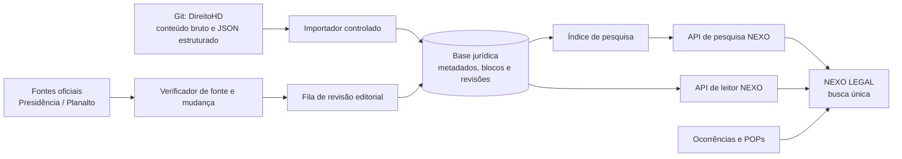

# NEXO LEGAL — Leitor interno e busca jurídica unificada

## Decisão arquitetural

O comportamento desejado não deve ser implementado como uma página externa “dentro” de um quadro. O NEXO LEGAL deve abrir um **leitor próprio**, alimentado pelos documentos estruturados e versionados no repositório DireitoHD, mantendo no cabeçalho a fonte, o estado da conferência e o botão opcional para a origem oficial. Assim, o usuário continua no aplicativo, usa uma única busca e não perde a navegação, os POPs ou o contexto da ocorrência.

> Quando o usuário tocar em “Consultar”, a rota deve ser interna — por exemplo, `/biblioteca/lei-11340/art-12` — e não uma URL do DireitoHD ou do Planalto.

A incorporação com `iframe` pode até funcionar provisoriamente em uma rota sem bloqueios, mas não é base adequada para o produto. O próprio provedor pode passar a bloquear o enquadramento com `X-Frame-Options` ou `Content-Security-Policy: frame-ancestors`, e o navegador impede que a página-pai leia ou pesquise livremente o DOM de outro domínio pela política de mesma origem. [5] [6] [7]

| Requisito | Solução no NEXO LEGAL |
| --- | --- |
| Permanecer no aplicativo | Leitor interno com rotas próprias e navegação NEXO LEGAL. |
| Usar o conteúdo do Git | Conversor importa catálogo e blocos estruturados a partir de um commit identificado. |
| Pesquisar por lei, artigo, inciso e assunto | Índice no servidor com análise de consulta equivalente à já existente no repositório. |
| Abrir fonte normativa | Link explícito “Conferir na fonte oficial”, sem quebrar o contexto do leitor. |
| Priorizar atividade policial-militar | Ranqueamento, chips e atalhos para POPs/ocorrências, sem excluir o acervo jurídico geral. |
| Manter atualização e rastreabilidade | Registro de origem, hash, data da coleta, diferença por revisão e validação editorial. |

## O que já existe no Git

O repositório `socrateslever1/www.direitomobile.com` já contém a parte mais onerosa do projeto: um catálogo estruturado e um leitor que trabalha por demanda. No estado inspecionado, há **539 documentos**, aproximadamente **96 MB** de JSONs estruturados, **157.701 blocos** e **19.059 âncoras de artigo**; o índice geral ocupa cerca de **752 KB**. Esses números tornam inadequado enviar o acervo inteiro ao navegador logo na abertura. [1]

O script `tools/build-dhd-data.js` converte os HTMLs em documentos com título, descrição, tipo, artigos, incisos, alíneas, blocos, índice e links. O módulo `assets/dhd-enhance.js` já normaliza acentos, interpreta referências normativas, extrai variações numéricas, pontua resultados e busca somente os documentos necessários. A pull request aberta #1 também apresenta uma evolução em React com catálogo automático, leitor modular, busca, explicações, relações e preparação para comentários. [1] [2]

O Git deve ser tratado como **fonte de trabalho e trilha de auditoria do acervo**. Toda importação para o NEXO LEGAL guarda o SHA do commit de origem; uma alteração editorial no aplicativo não substitui o material bruto versionado.

## Arquitetura proposta

### Camada de dados

O projeto deve evoluir de interface estática para uma aplicação com banco de dados e rotas de servidor. O objetivo não é guardar cópias grandes no navegador, e sim servir resultados pequenos e cacheáveis.

| Entidade | Função | Campos indispensáveis |
| --- | --- | --- |
| `legal_document` | Uma norma, código, súmula ou ato. | `id`, `slug`, `title`, `kind`, `law_number`, `official_url`, `git_path`, `git_commit`, `status`, `official_checked_at`. |
| `legal_block` | Trecho estruturado da norma. | `document_id`, `position`, `kind`, `article`, `paragraph`, `inciso`, `alinea`, `text`, `safe_html`, `search_text`. |
| `legal_revision` | Histórico imutável de conferência. | `document_id`, `source_hash`, `content_hash`, `collected_at`, `change_summary`, `review_status`, `reviewed_by`. |
| `legal_relation` | Liga normas, artigos, ocorrências e POPs. | `from_type`, `from_id`, `to_type`, `to_id`, `relation_type`, `priority`. |
| `source_registry` | Lista de fontes permitidas e seus critérios. | `source_name`, `base_url`, `access_policy`, `refresh_policy`, `attribution`, `enabled`. |
| `import_run` | Auditoria da carga. | `git_commit`, `started_at`, `finished_at`, `documents_added`, `documents_changed`, `errors`. |

O texto integral e a marcação deverão ser sanitizados durante a importação. Apenas um conjunto limitado de elementos semânticos — como parágrafo, ênfase, lista e link permitido — entra no leitor. Links externos mantêm `noopener` e não são reescritos como se fossem conteúdo próprio.

### Busca única

A busca do NEXO LEGAL receberá uma consulta, por exemplo, `Lei 11.340 art. 12`, `ameaça`, `art. 244 CPP` ou `violência doméstica`. O servidor normaliza acentos, identifica referência de lei, artigo, inciso, alínea e palavras-chave e pesquisa o índice. A resposta inicial retorna no máximo 20 resultados compactos: título, artigo, trecho destacado, tipo de conteúdo, fonte e estado de conferência.

O ranqueamento deve favorecer, nesta ordem, correspondência exata de lei/artigo, documento com status conferido, ocorrência/POP relacionado e, por último, relevância textual. O foco policial-militar é assim um **sinal de prioridade**, não uma limitação do direito pesquisável. A pessoa continua podendo buscar Constituição, Código Civil ou norma ambiental, mas a primeira tela destaca o que possui relação operacional com o contexto corrente.

Uma segunda busca dentro do documento filtra somente seus blocos. O leitor carrega por artigo ou por faixa de blocos, de modo que códigos extensos não causem transferência nem renderização excessiva.

### Leitor interno

O leitor deve mostrar, em uma única tela do NEXO LEGAL, a identificação da norma, seu status, data de conferência, índice de artigos, régua de leitura, controle de tipografia e um bloco de contexto operacional quando houver ligação com POPs ou ocorrência. A fonte oficial ficará visível como metadado e como ação explícita, mas o usuário só sairá do aplicativo se escolher conferi-la.

O conteúdo local deve aparecer com um dos estados abaixo, nunca com uma afirmação genérica de que está “atualizado”.

| Estado | Significado na interface |
| --- | --- |
| **Conferido** | Texto e origem oficial foram comparados e aprovados por revisão humana em data registrada. |
| **Mudança detectada** | A fonte registrada mudou; a versão anterior continua rastreável, mas aguarda validação. |
| **Importado do Git** | Conteúdo estruturado está disponível, porém ainda exige conferência oficial. |
| **Somente referência** | O aplicativo tem metadados e URL da fonte, mas não exibe texto interno. |

## Atualização responsável

A Base da Legislação Federal da Presidência permite pesquisa por palavras-chave e por filtros como tipo, identificação, período e situação; ela informa reunir atos federais de hierarquia superior e ser constantemente atualizada. [3] O serviço público “Push da Legislação” também permite receber, por e-mail, informações diárias sobre novos atos federais de hierarquia superior assinados pelo Presidente da República e publicados no DOU. [4]

Esses recursos devem ser usados como **sinal de atualização e fonte de conferência**, não como permissão presumida para copiar integralmente páginas ou automatizar todo o portal. Não foi identificada uma API pública documentada nas fontes examinadas. Antes de automatizar obtenção de texto, o projeto precisa registrar, para cada fonte, a base de uso, atribuição, frequência permitida e forma de acesso aprovada.

O fluxo recomendado é o seguinte:

1. Um trabalho diário verifica apenas documentos já registrados como prioritários — Constituição, CP, CPP, Lei Maria da Penha, CTB, Lei de Drogas, Lei Orgânica das PMs e demais fontes ligadas aos POPs.
2. Quando a fonte oferecer `ETag` ou `Last-Modified`, o processo usa esse sinal. Caso contrário, compara hash de texto normalizado com controle de frequência e limites de requisição.
3. Qualquer diferença cria uma nova `legal_revision` e entra em fila de revisão, mostrando os blocos modificados lado a lado com a versão anterior.
4. Após conferência editorial, o novo texto é promovido a **Conferido**, o índice é regenerado e o app passa a exibir a data de validação.
5. O restante do acervo recebe verificação menos frequente, por categoria e risco, evitando carga excessiva e concentrando o cuidado onde há impacto operacional.

Esse processo é determinístico e periódico; deve rodar em segundo plano na infraestrutura do aplicativo, sem exigir que o usuário mantenha o navegador aberto. Uma frequência diária é suficiente para o escopo inicial e não justifica um processo em execução contínua. A área administrativa precisa permitir pausar fonte, reprocessar uma norma, aprovar uma revisão e ver erros da importação.

## Alternativas de implantação

| Abordagem | Resultado para o usuário | Vantagens | Limitações |
| --- | --- | --- | --- |
| **Leitor interno com acervo do Git e conferência oficial** | Consulta, busca e POPs permanecem no NEXO LEGAL; fonte oficial é opcional. | Cumpre a experiência desejada, é pesquisável, auditável e permite cache seletivo. | Exige banco de dados, camada de servidor, rotina de importação e revisão editorial. |
| **Catálogo interno com abertura da fonte em nova guia** | O usuário pesquisa no NEXO, mas lê o texto em site externo. | Implementação leve e rápida; baixo risco de republicação. | Não cumpre a exigência de leitura dentro do layout próprio. |
| **Quadro externo experimental** | O site de terceiros aparece visualmente dentro do aplicativo quando permitido. | Rápido para demonstrar uma rota pontual. | Frágil a políticas de incorporação, difícil de pesquisar, sem controle de design e com risco de quebra futura. Não é recomendado como produto. |

## Sequência de implementação

| Etapa | Entrega | Critério de aceite |
| --- | --- | --- |
| 1. Preparar a base | Aplicação com banco, API e área administrativa restrita. | O NEXO LEGAL pode registrar fontes, documentos e importações sem expor edição ao público. |
| 2. Importar o Git | Conversor de JSONs e catálogo, associado ao SHA do commit. | Um documento do Git abre no leitor interno com índice e fonte identificada. |
| 3. Liberar busca | Busca por lei, artigo, inciso, alínea e assunto, com filtros. | A consulta `Lei 11.340 art. 12` retorna o artigo e seu contexto. |
| 4. Conectar contexto operacional | Relações entre artigos, ocorrências e POPs. | A ficha de Maria da Penha mostra procedimento e normas relacionadas, com estado de conferência. |
| 5. Atualizar e revisar | Registro de fontes, tarefas diárias, diff de versões e aprovação. | Uma alteração detectada não substitui o texto conferido sem registro e validação. |
| 6. Expandir cobertura | Importação gradual das demais áreas jurídicas. | O catálogo amplo cresce sem alterar o tempo de abertura da home ou do leitor. |

## Confirmações necessárias antes da implementação

A solução que atende integralmente ao comportamento pedido é a primeira alternativa da tabela: leitor interno alimentado pelo Git, com fonte oficial e atualização controlada. Para iniciar, preciso apenas da confirmação de que a aplicação deve ser ampliada para armazenar o catálogo e as revisões, e de que o conteúdo versionado no repositório pode ser publicado sob a identidade NEXO LEGAL com a atribuição por documento. A pull request #1 deve ser usada como referência de arquitetura, mas não será mesclada nem alterada sem sua autorização explícita.

## Referências

[1] [Repositório `socrateslever1/www.direitomobile.com`](https://github.com/socrateslever1/www.direitomobile.com)

[2] [Pull request #1 — Construir fundação do novo portal jurídico](https://github.com/socrateslever1/www.direitomobile.com/pull/1)

[3] [Pesquisa de Legislação da Presidência da República](https://legislacao.presidencia.gov.br/)

[4] [Serviço Push da Legislação — Gov.br](https://www.gov.br/pt-br/servicos/receber-notificacoes-sobre-as-legislacoes-disponibilizadas-no-portal-da-legislacao-push-da-legislacao)

[5] [X-Frame-Options — MDN](https://developer.mozilla.org/en-US/docs/Web/HTTP/Reference/Headers/X-Frame-Options)

[6] [CSP `frame-ancestors` — MDN](https://developer.mozilla.org/en-US/docs/Web/HTTP/Reference/Headers/Content-Security-Policy/frame-ancestors)

[7] [`iframe` e política de mesma origem — MDN](https://developer.mozilla.org/en-US/docs/Web/HTML/Reference/Elements/iframe)
